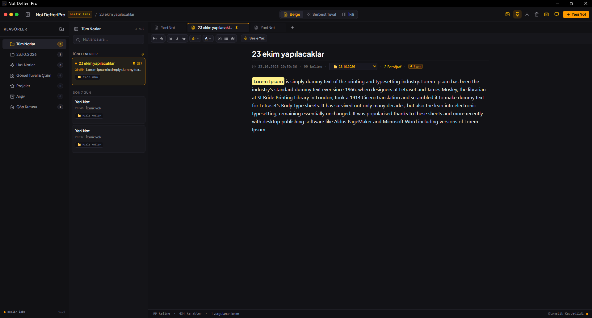

# 📝 Not Defteri Pro

Modern, minimalist ve güçlü bir masaüstü seviyesinde not alma ve görsel tuval uygulaması. Zengin metin düzenleme (WYSIWYG), sesli not dikte etme (mikrofonla konuşarak yazma), serbest vektör tuval çizimi ve gelişmiş görsel yönetimini tek bir çatı altında birleştirir.

[](https://reactjs.org/)
[](https://www.typescriptlang.org/)
[](https://tailwindcss.com/)
[](https://vercel.com)
[](https://github.com/sponsors/ocalirdigital)
[](https://checkout.dodopayments.com/buy/pdt_0NqNaai72jdmYgFMZLV0j?quantity=1)

---

<div align="center">
  
</div>

---

## 🌐 Web Sitesi / Canlı Yayına Alma (Vercel)

Not Defteri Pro, **%100 istemci taraflı (client-side SPA)** olarak tasarlanmıştır. Vercel, Netlify veya GitHub Pages üzerinde sıfır sunucu maliyetiyle tek tıkla canlıya alıp istediğiniz cihazdan web sitesi olarak kullanabilirsiniz:

[](https://vercel.com/new/clone?repository-url=https%3A%2F%2Fgithub.com%2Focalirdigital%2FNot-Defteri-PRO)

> [!TIP]
> Vercel hesabınıza GitHub ile giriş yapıp `Not-Defteri-PRO` reponuzu seçtiğinizde, proje ayarları (Vite + SPA yönlendirmeleri `vercel.json` ile) otomatik olarak algılanır ve saniyeler içinde ücretsiz canlı web adresiniz oluşturulur.

---

## 💖 Projeye Destek Ol / Bana Bir Kahve Ismarla

Bu projeyi beğeniyorsanız, geliştirilmesine katkıda bulunmak ve yeni özelliklerin eklenmesini desteklemek için bağış yapabilirsiniz!

<div align="center">

<a href="https://checkout.dodopayments.com/buy/pdt_0NqNaai72jdmYgFMZLV0j?quantity=1" target="_blank">
  
</a>
&nbsp;&nbsp;
<a href="https://github.com/sponsors/ocalirdigital" target="_blank">
  
</a>

<p align="center">
  <sub>Ödeme ve bağışlar <b>Dodo Payments</b> ve <b>GitHub Sponsors</b> altyapısı ile güvenle işlenir.</sub>
</p>

</div>

---

## 🚀 Başlıca Özellikler

- 🎙️ **Sesli Not Yazma (Mikrofon Dikte):** Mikrofonunuza konuşun, sesiniz Türkçe olarak anında metne dökülsün.
- 🎨 **Serbest Görsel Tuval (Canvas):** Kartları, fotoğrafları ve yapışkan notları serbestçe yerleştirin, boyutlandırın ve organize edin.
- ✏️ **Vektör Çizim & Sürükleme:** Tuval üzerinde serbest çizim yapın, çizdiğiniz şekil veya yazıları sonradan fareyle tutup dilediğiniz yere sürükleyin, rengini değiştirin veya silin.
- 🖼️ **Akıllı Fotoğraf Yerleşimi:** Fotoğraf yapıştırdığınızda veya eklediğinizde var olan ögelerin üzerine binmez, otomatik olarak yan yana veya alt satıra nizami olarak sıralanır.
- 📄 **Zengin Metin Editörü (WYSIWYG):** Başlıklar, alıntılar, kod blokları, çok renkli fosforlu vurgular (sarı, yeşil, mavi) ve gerçek zamanlı kelime/karakter sayacı.
- 🗂️ **Klasör ve Sekme Sistemi:** Notlarınızı klasörlere ayırın, sürükle-bırak ile klasörler arasında taşıyın, birden fazla notu tarayıcı benzeri sekmelerde açın.
- ⚡ **Tamamen Yerel & Gizli:** Tüm notlarınız ve verileriniz bilgisayarınızda yerel olarak saklanır.

---

## 💻 Hızlı Başlangıç

### Tek Tıkla Başlatma (Windows)
Klasör içindeki **`baslat.bat`** dosyasına çift tıklayarak uygulamayı pencere boyutunda doğrudan açabilirsiniz.

### Manuel Kurulum & Çalıştırma
```bash
# 1. Bağımlılıkları yükleyin
npm install

# 2. Geliştirici sunucusunu başlatın
npm run dev
```
Uygulama varsayılan olarak `http://localhost:3000` adresinde çalışacaktır.

---

## 👨‍💻 Geliştirici

Bu proje **[Ocalir Labs](https://github.com/ocalirdigital)** tarafından geliştirilmiştir.
Telif Hakkı © 2026 Ocalir Labs. MIT Lisansı ile lisanslanmıştır.

